# 초기 데이터 설계

설계일: 2026-09-21. 상태: 초기 SQL 계약을 앱 migration/repository로 구현했다.
실제 작품 대신 기술용 fixture로 검증하며, 상세 결과는 implementation-validation.md에 기록한다.

## 범위와 전제

iOS/Android, 한 기기의 한 플레이어, 오프라인, 작품별 활성 플레이 1개를 기본으로 한다.
회원·서버·결제·알림·다중 저장 슬롯·에피소드 테이블은 현재 요구가 없어 만들지 않는다.
개발 순서는 데이터 계약 → 진행 엔진 → 저장소 → 기본 화면 → 실제 콘텐츠다.
content/drafts 아래의 opening concept는 아이디어 샘플이며 앱에 연결하지 않는다.

## 세 종류의 데이터

1. 제작 원장: 장면·본문 블록·선택·에셋·연출 cue와 제작 상태를 관리하는 테이블. 앱에는 포함하지 않는다.
2. 콘텐츠 패키지: 제작 원장에서 빌드해 앱에 번들한 불변 JSON과 승인 에셋.
3. 기기 SQLite: 작품/배포 버전의 참조 목록과 플레이어의 진행·설정만 저장.

원고 전체를 SQL로 복제하지 않는다. story/story_release는 콘텐츠 원본이 아니라
저장 데이터가 어느 번들을 가리키는지 확인하는 최소 참조 목록이다.
등록 전 콘텐츠 검증을 수행하고 같은 버전의 다른 해시는 덮어쓰지 않고 오류로 처리한다.
제작 원장 구조와 import/export 경계는 [콘텐츠 제작 원장 설계](content-authoring-plan.md)를 따른다.

## 물리 ERD: 기기에 저장하는 7개 테이블

원본: [Mermaid](erd.mmd) / SQL: [schema.sql](../design/schema.sql)

| 테이블 | 책임 | 키와 주요 규칙 |
| --- | --- | --- |
| story | 작품의 영구 ID | story_id; 명칭을 바꿔도 ID 유지 |
| story_release | 작품의 불변 콘텐츠 버전 | (story_id, content_version), SHA-256, 콘텐츠/엔진 규격 버전 |
| playthrough | 한 번 시작한 플레이 | UUID; 현재 노드, 상태, revision; 작품당 active 최대 1개 |
| playthrough_flag | 선택으로 바뀐 boolean 상태 | (playthrough_id, flag_id), 값 0/1 |
| choice_history | 선택한 순서와 경로 | (playthrough_id, sequence), 1부터 순차 증가 |
| ending_unlock | 기기에서 수집한 엔딩 | (story_id, ending_id), 최초 발견 버전과 시간 |
| app_settings | 앱 공통 설정 | singleton_id=1 한 행, 글자 배율·동작 줄이기 |

본문과 선택지 ID는 콘텐츠 패키지를 가리키므로 SQL 외래키가 아니다.
DB는 플레이와 작품 버전의 관계까지 강제하며, 실제 노드·선택·flag·엔딩 존재 및
동일 작품 내 연결은 콘텐츠 검증기와 진행 엔진이 강제한다. 이 경계를 숨기지 않는다.
복합 외래키에서 두 컬럼은 한 쌍이다. ERD의 FK 표시는 각 컬럼이 별도 참조라는 뜻이 아니다.

## 콘텐츠 논리 모델: SQL 테이블이 아님

[Mermaid 원본](content-model.mmd). NODE/CHOICE 등의 ID는 작품 버전 안에서 유일하다.
그림은 가독성을 위해 부모 복합키를 생략했다. 실제 식별은 (storyId, version, nodeId),
선택지는 (storyId, version, nodeId, choiceId)다. endingId는 작품의 여러 버전에서 의미를 유지한다.

- 노드는 처음에는 letter와 ending만 지원한다. letter는 선택지가 1개 이상, ending은 0개.
- 모든 선택은 같은 작품 버전 안의 다음 노드 하나를 가리킨다.
- 조건은 선언된 boolean flag의 equals를 AND로 평가한다. 조건 없음은 항상 허용.
- 효과는 선언된 boolean flag에 true/false를 대입한다. 임의 코드나 eval은 없다.
- flag 미저장 시 해당 불변 콘텐츠 버전의 defaultValue를 적용한다.
- 신뢰도 등 숫자 점수는 초기 미지원이다. 첫 이야기에서 필요하면 계약과 테스트를 확장한다.
- 첫 버전은 유한 DAG로 제한한다. 반복 방문·시간 이벤트는 후속 설계 대상이다.
- 도달 가능한 모든 비종료 상태에는 선택 가능한 항목이 하나 이상 있어야 한다.

## 저장 트랜잭션 계약

한 연결에서 foreign_keys=ON을 설정한 뒤 하나의 전용 트랜잭션으로 실행한다.
구현은 전용 expo-sqlite 연결의 직렬 큐를 사용한다. foreign_keys를 활성화한 바로 그 연결에서
BEGIN IMMEDIATE/COMMIT/ROLLBACK을 실행하고 모든 조회도 큐에 넣는다. 별도 연결에서 FK 설정이
누락되거나 관련 없는 비동기 쿼리가 트랜잭션에 섞이는 것을 피한다.

1. UI가 playthroughId, expectedRevision, 현재 nodeId, choiceId를 전달한다.
2. 트랜잭션 안에서 active 상태, revision, 현재 노드, 번들 버전과 해시를 검사한다.
3. 해당 선택의 조건을 평가하고 새 flag·다음 노드·종료 여부를 메모리에서 계산한다.
4. revision 조건부 UPDATE가 정확히 1행을 바꿨는지 확인한다. 아니면 전체 취소.
5. flag 변경, choice_history(sequence=이전 revision+1), 현재 노드/revision 갱신을 함께 저장한다.
6. 결말 진입이면 status=completed, finished_at_ms와 ending_unlock을 같은 트랜잭션에 기록한다.
7. commit 후에만 화면을 전환한다. 실패 시 기존 화면에서 재시도한다.

중복 탭/응답 유실 후 재요청은 동일 revision으로 다시 반영하지 않는다.
이미 commit된 경우 저장 상태를 다시 읽어 화면을 맞춘다. 렌더링 시 효과를 재실행하지 않는다.
초기 revision=0, 첫 선택 sequence=1. 연속 번호와 revision 일치는 저장 계층의 책임이다.
시간은 UTC epoch milliseconds로 저장하며 순서는 시계 대신 sequence로 판단한다.
기기 시계가 뒤로 가면 갱신 시각은 max(현재 시간, 이전 updated_at_ms)를 사용한다.

## 이어하기·기록·새로 시작

- 이어하기는 active 플레이에 고정된 콘텐츠 버전을 로드하고 현재 노드를 표시한다.
- 받은 편지 목록은 시작 노드와 history의 도착 노드를 순서대로 읽어 구성한다.
  별도 읽음 시각/읽음 여부는 초기 요구가 없어 저장하지 않는다.
- 새로 시작은 기존 active를 abandoned로 바꾸고 새 UUID 플레이를 만드는 단일 트랜잭션이다.
- completed/abandoned 기록은 초기에는 보존하며 엔딩 해금은 새 시작으로 지우지 않는다.
- 전체 데이터 초기화는 진행/선택/flag/엔딩을 삭제하고 설정을 기본값으로 복구한다.
  화면에서 확인을 받고 번들 참조 목록은 다시 등록 가능하도록 유지한다.
- 플레이 삭제 시 flag/history는 CASCADE 삭제, 엔딩 해금은 남는다.
- 작품 목록 요약은 최신 playthrough의 버전·상태·revision과 ending_unlock ID를 조회한다. 화면은 현재 노출 버전에 존재하는 엔딩만 집계해 구버전 ID가 남아도 표시 총개수를 넘지 않는다.
  본문이나 선택 이력을 중복 저장하지 않고 예상 읽기 시간·전체 엔딩 수는 번들 원고에서 계산한다.

## 버전과 마이그레이션

- PRAGMA user_version: 물리 DB 스키마 버전. migration 실행기가 순차적으로 관리.
- 현재 DB v2는 오디오 기능 없이 예약됐던 `sound_enabled`를 제거한다. v1의 글자 배율과 동작 줄이기 값은 유지한다.
- content_schema_version: JSON 구조 버전. 지원하지 않는 값은 플레이 전에 거절.
- engine_contract_version: 조건/효과 의미의 버전. 지원하지 않는 값은 거절.
- content_version: 한 작품 원고와 그래프의 불변 버전. 오탈자 수정도 새 버전.
- content_hash: 배포할 UTF-8 JSON 파일의 정확한 바이트에 대한 SHA-256 소문자 hex.

초기 업데이트는 진행 중인 구버전 콘텐츠를 앱 번들에 함께 유지한다.
새 플레이만 최신 버전으로 시작한다. 구버전이 없으면 저장을 덮어쓰거나 자동 초기화하지 않고
호환 불가 안내와 명시적인 새 시작 선택을 제공한다. 번들 누락 여부는 출시 전 검사한다.
노드 매핑 마이그레이션과 다운로드 콘텐츠는 후속 범위다.

## SQL이 보장하는 것과 이후 구현에서 검증할 것

SQL: 참조 무결성, 동일 작품 활성 플레이 중복, 상태/종료시각 형식, boolean 범위,
설정 범위, 순번 중복, 엔딩 중복, 삭제 정책.
엔진/저장 계층: 콘텐츠 내부 참조, 조건 평가, 모든 엔딩 도달, 번호 연속성,
completed가 실제 ending 노드인지, 해시 불변, flag 기본값, CAS 재시도, 실제 기기 파일 영속성.
콘텐츠/저장 계층 자동 테스트 결과와 실제 기기 검증 결과는 implementation-validation.md에서 구분한다.

## 검증과 재생성

- `pnpm design:check`: Python 표준 SQLite로 SQL 제약/rollback/재시작 계약 검증.
- `pnpm design:render`: 물리 ERD SVG 재생성.
- `pnpm design:render:content`: 콘텐츠 모델 SVG 재생성.
- SQLite 3.37 이상(STRICT 테이블 사용), Node 24, Python 3, pnpm 필요.
- 테스트 픽스처는 실제 게임 콘텐츠가 아닌 최소 기술용 데이터다.

## 근거

- [SQLite 외래키](https://www.sqlite.org/foreignkeys.html): 연결마다 활성화, 복합키.
- [SQLite PRAGMA](https://www.sqlite.org/pragma.html): user_version과 외래키 설정.
- [Expo SQLite](https://docs.expo.dev/versions/latest/sdk/sqlite/): 기기 저장과 트랜잭션 API.
- [Mermaid CLI](https://github.com/mermaid-js/mermaid-cli): ERD를 SVG로 생성.
